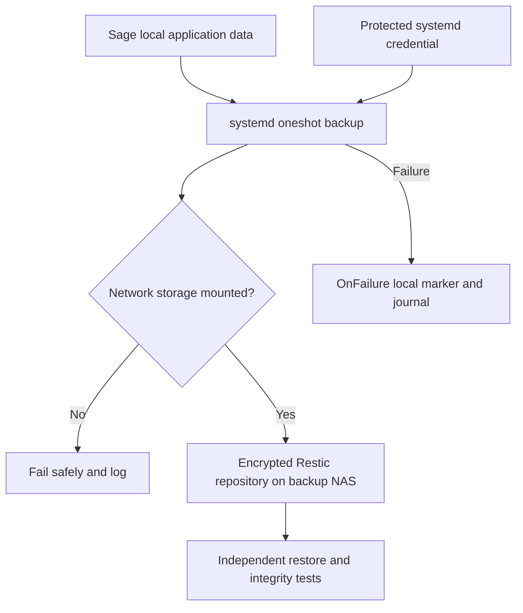

# Milestone 00 — Infrastructure Foundation: verification report

Date: 2026-10-24. Status: **Final sign-off pending** (remaining operational gaps below).

## Verified

- Ubuntu 24.04 LTS, systemd checks, rootless Podman 6.1.2 and NVIDIA 595.99.02 driver.
- Local LVM root and application-data volumes inspected for usage.
- Two network-storage automounts triggered successfully; directory access, writing, SHA-256 validation and cleanup passed on both.
- Encrypted Restic repository initialized and snapshot creation demonstrated.
- Recovery test restored 21 filesystem entries to an isolated temporary directory; restored application content matched source exclusions.
- Full Restic `check --read-data` passed without errors.
- A oneshot systemd backup service ran successfully as an unprivileged user using `LoadCredential`, and a persistent daily timer was enabled.
- Backup failure handler was registered with `OnFailure` and tested independently; marker creation was verified. An actual failed-backup trigger was **not** tested.
- Each of two locally installed GPUs was individually visible in a rootless Podman container using NVIDIA CDI and `nvidia-smi`. AI model performance and simultaneous-load behavior have not been tested.

## Logical flow

## Backup scope and current limitations

Initial scheduled backups cover application, configs, data, RAG, docs and container directories. Git metadata and generated caches are excluded. Models are not in this schedule. Database-consistent exports, NAS-to-NAS replication, and an unattended end-to-end disaster recovery rehearsal remain future work.

A retention policy of seven daily, four weekly and six monthly periods was **dry-run tested only**; automatic snapshot deletion and pruning are not enabled. Its treatment of multiple same-day snapshots requires further validation. Backups must be checked for recent successful runs; the local failure marker does not send remote notifications and is not automatically cleared on subsequent success. The backup destination must have separately secured recovery credentials, and write-access control alone does not protect against intentional repository deletion.

## Follow-up before formal sign-off

1. Confirm a scheduled (not manually triggered) backup succeeds after the next timer firing.
2. Verify failure-marker state and document the manual clear procedure; test the actual `OnFailure` path in an isolated unit.
3. Decide whether deferred data-consistency and disaster-recovery items are in scope for Milestone 00 or tracked as accepted risks.
4. Complete the practical-assessment rubric and link the private operational evidence without publishing sensitive details.

## Learning connections

Hands-on topics: systemd units/timers and journald, file ownership, mounted filesystems, LVM, NFS automounts, Bash failure handling, rootless containers, GPU CDI. These overlap Linux administrator certification skills, but are not a claim of exam-objective completion.
